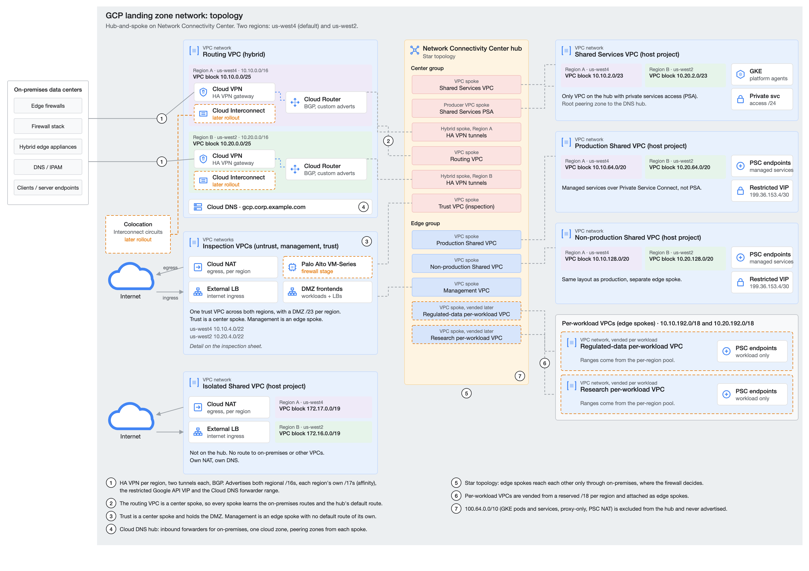
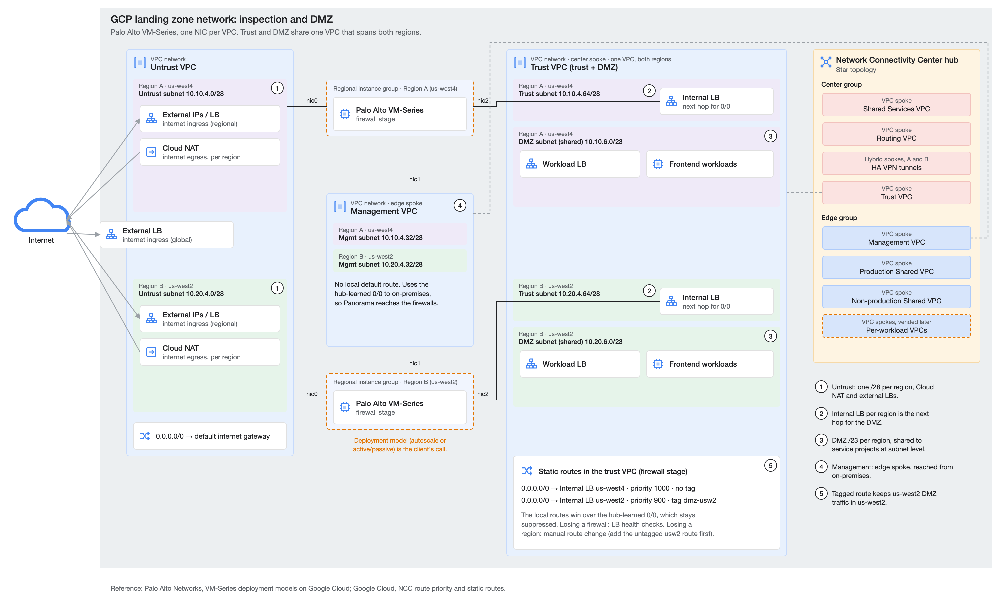

# GCP Landing Zone Network: NCC Hub-and-Spoke Case Study

> The network layer of a greenfield Google Cloud landing zone for a large healthcare organization. Hub-and-spoke on Network Connectivity Center, HA VPN with BGP to two data centers, a DMZ behind Palo Alto VM-Series firewalls, and the whole network defined as one YAML file that drives an OpenTofu stage. Client names, domains and address space are replaced with examples. The design, decisions and code are the real ones.



---

## Table of Contents

1. [Project Context](#1-project-context)
2. [The Problem](#2-the-problem)
3. [Architecture Overview](#3-architecture-overview)
4. [Design Decisions and Defense](#4-design-decisions-and-defense)
5. [Inspection and DMZ](#5-inspection-and-dmz)
6. [Validation](#6-validation)
7. [Repository Structure](#7-repository-structure)
8. [Deployment](#8-deployment)
9. [Lessons Learned](#9-lessons-learned)
10. [Roadmap](#10-roadmap)

---

## 1. Project Context

The organization was standing up its first Google Cloud environment, Jul to Oct 2026. I was the network architect and lead network engineer: I designed the topology and IP plan, wrote the network config and the reference stage, tested each design point in a sandbox, and ran the design reviews with the client's network team, Google and Palo Alto Networks. The client's engineers own the deployment pipeline and run the merge and apply.

The client already had a mature on-premises network: two data centers, edge firewalls, an IPAM and DNS platform, and a network team that wanted the cloud to follow its rules rather than invent new ones.

---

## 2. The Problem

The network had to:

- connect to both data centers over HA VPN now, with Interconnect to follow,
- keep production, non-production and regulated workloads apart, with the on-premises firewall as the one place that decides what crosses between them,
- run in two regions: us-west4 as the cost default, us-west2 only for latency-sensitive work, with traffic staying in its own region,
- give public-facing workloads a DMZ behind VM-Series firewalls without changing how every other VPC reaches the internet,
- fit the client's existing IaC pattern, where config lives in YAML in one repo and the modules that read it live in another, so their team edits data and not Terraform.

Constraints that shaped the design:

- The network team required one routable /16 per region and nothing else from the corporate space.
- GKE pod and service ranges are large and must never be advertised on-premises.
- The firewall deployment model (autoscale or active/passive) was still open, so the network had to support either.
- Everything had to survive a review by Google's own network specialist.

---

## 3. Architecture Overview

| Piece | How it works |
|---|---|
| Center group | Routing VPC (HA VPN and Cloud Routers), Shared Services, the trust VPC and the VPN tunnel spokes. Center spokes see everything. |
| Edge group | Production, non-production, management and per-workload VPCs. Edge spokes see the center but not each other. |
| Hybrid | HA VPN per region, two tunnels each, BGP with custom advertisements: both regional /16s, each region's own /17s for affinity, the restricted Google API VIP (199.36.153.4/30) and the Cloud DNS forwarder range (35.199.192.0/19). |
| Addressing | One /16 per region with the same layout in both, so moving a region changes only the second octet. |
| Local-only space | GKE pods and services, proxy-only and PSC NAT subnets sit in 100.64.0.0/10, excluded from the hub on every spoke and never advertised. |
| DNS | One hub with inbound forwarders for on-premises, one cloud zone, peering zones from every spoke. On-premises DNS stays authoritative for the corporate domain. |
| Managed services | Private Service Connect in prod and non-prod. Private services access only in Shared Services. |
| Isolated | A separate Shared VPC, not on the hub, with its own NAT and DNS. |

### Address plan (us-west4; us-west2 is the same in 10.20)

| VPC | Block |
|---|---|
| Routing (hybrid) | 10.10.0.0/25 |
| Shared Services | 10.10.2.0/23 (PSA in 10.10.3.0/24) |
| Security (untrust, mgmt, trust /28s, DMZ /23) | 10.10.4.0/22 |
| Production | 10.10.64.0/20 |
| Non-production | 10.10.128.0/20 |
| Per-workload pool | 10.10.192.0/18 |
| Isolated | 172.17.0.0/19 (us-west2 172.16.0.0/19) |

---

## 4. Design Decisions and Defense

### NCC star, not a mesh or VPC peering

Star gives two route tables. Edge spokes never learn each other's routes, so prod to non-prod has no path in the cloud at all and has to go through the on-premises firewall. I chose that over firewall rules because a missing route can't be misconfigured. I proved the center and edge behavior in a sandbox before proposing it, including the gotcha that a spoke created before its project is on the group's auto-accept list stays INACTIVE for good.

### The routing VPC is a spoke too

The VPN tunnels are hybrid spokes, but the VPC that holds them is also a center VPC spoke. That puts the Cloud DNS forwarder path and the Google API routes on the hub without extra plumbing.

### Regional affinity through BGP, not a primary region

Both regions advertise both /16s with equal priority, and each also advertises its own /17s. Longest prefix wins, so on-premises sends each region's traffic to that region's tunnels, and the /16s give automatic failover if a region drops. A single-primary design would have hauled us-west2 traffic through us-west4.

### No deny rule between prod and non-prod

The first draft had one. The client's network team asked for it to go: they wanted one policy point, on-premises, and the star topology already guarantees there is no cloud path. Removing it made the design simpler and matched their operating model.

### Advertise the restricted VIP instead of a PSC endpoint for Google APIs

Advertising 199.36.153.4/30 from the hub lets on-premises and every spoke reach Google APIs through VPC Service Controls with no per-VPC endpoint. I tested PSC for APIs as well; exporting PSC endpoints between VPCs did not work for this case, so the VIP was the defensible choice.

### PSC for managed services in prod and non-prod

Private services access needs a peering per VPC and a producer spoke on the hub. Moving prod and non-prod to Private Service Connect removed two peerings, two producer spokes and their range allocations, and left PSA in Shared Services only.

### Management as an edge spoke with no default route

Panorama on-premises has to reach the firewall management interfaces. Making management an edge spoke gives it that path. Deleting its own default route at creation makes it use the hub's route instead of the internet. That flag only works at creation, so it had to be right before the first apply.

---

## 5. Inspection and DMZ



The firewalls have one NIC per VPC: untrust, management and trust. The DMZ subnets live inside the trust VPC, one /23 per region, in a single VPC that spans both regions.

The trust VPC is a center spoke, so it learns the on-premises default route from the hub. Two local static routes take precedence over it:

| Route | Next hop | Priority | Applies to |
|---|---|---|---|
| 0.0.0.0/0 | Internal LB, us-west4 | 1000 | everything in the DMZ |
| 0.0.0.0/0 | Internal LB, us-west2 | 900 | instances tagged `dmz-usw2` |

Why it is built this way:

- NCC does not carry network tags between spokes, so a separate DMZ spoke can't steer by region. Keeping the DMZ in the same VPC as the load balancers makes tagged routes work.
- The hub-learned default is suppressed, not removed. It shows under "Show suppressed routes" and comes back on its own if the local routes are deleted.
- Spoke VPCs never see these routes and keep egressing through on-premises.
- A failed firewall is handled by load balancer health checks. Losing a region is a manual route change, accepted for phase one: add the untagged us-west2 route first, then remove the us-west4 one, or untagged DMZ traffic falls back to on-premises.

I demonstrated this live to the client and Google's network specialist, walking the effective and suppressed routes in the console during a regional failover.

---

## 6. Validation

- Sandbox tests of every routing claim before it reached the client: NCC center and edge behavior, hairpin egress through on-premises, the DMZ route pair with a real VM-Series pair and failover, DNS forwarding and PSC.
- A 45-check design gate (`scripts/design-check.sh`) that tests the YAML against every agreed decision. The previous version of the config fails 11 of the checks, so they catch real regressions.
- Plans of the client's module and this stage against the final YAML, plus checks that no two ranges overlap, every range sits in its block and every routable range is advertised.

---

## 7. Repository Structure

```
config/network.yaml      the whole network as data: VPCs, subnets, NCC, VPN, DNS, routes, firewall
config/main.tf           reads the YAML and hands it to the stage
network/                 OpenTofu stage on Cloud Foundation Fabric v57 modules
scripts/design-check.sh  45 checks of the YAML against the design
docs/                    diagrams, SVG and PNG
```

The stage plans 169 resources against an empty project: 9 VPCs, the NCC hub with its groups and spokes, HA VPN with BGP, Cloud NAT, firewall policies, Google API routes and DNS.

---

## 8. Deployment

Requires OpenTofu 1.11+, `yq` and Python 3.

```sh
cd network
cp terraform.tfvars.example terraform.tfvars   # set prefix and the provider project
# create one Secret Manager secret per tunnel, named as psk_secret in network.yaml
tofu init
tofu plan
../scripts/design-check.sh ../config/network.yaml
```

Project IDs are `<prefix>-<project name>`. `project_id_overrides` points any project at another ID, for example to plan everything into one test project. The VPN peer addresses and ASNs in `network.yaml` are documentation examples.

Order on a real deployment: projects, then this stage with VPN and DNS off until the peer values are confirmed, then VPN, then DNS forwarding, then the firewall stage.

---

## 9. Lessons Learned

- Test before you claim. Every point that reached the client had a sandbox result behind it, which is what let the design hold up in front of Google.
- Some flags only work at creation. Deleting default routes is one; spoke auto-accept is another. Get them right before the first apply, because fixing them later means rebuilding.
- Let the client's operating model drive the security boundary. Their network team already owned inter-zone policy on-premises, so the cloud design routes to it instead of duplicating it.
- Put the design in a test. The 45-check gate turned meeting decisions into something a reviewer can run, and caught drift when the config moved between branches.
- Keep the config readable by the people who will own it. One YAML file with plain comments was easier for the client's team to review than any diagram.

---

## 10. Roadmap

- Firewall stage: VM-Series deployment, the DMZ route pair and firewall-path rules.
- Cloud Interconnect at the colocation site, with the VPN tunnels kept as backup.
- DNS forwarding to on-premises once the forwarder addresses are confirmed, and record delegation to spoke projects.
- Shared VPC service project attachment as application projects arrive.
- Automated cross-region DMZ failover in place of the manual route change.
